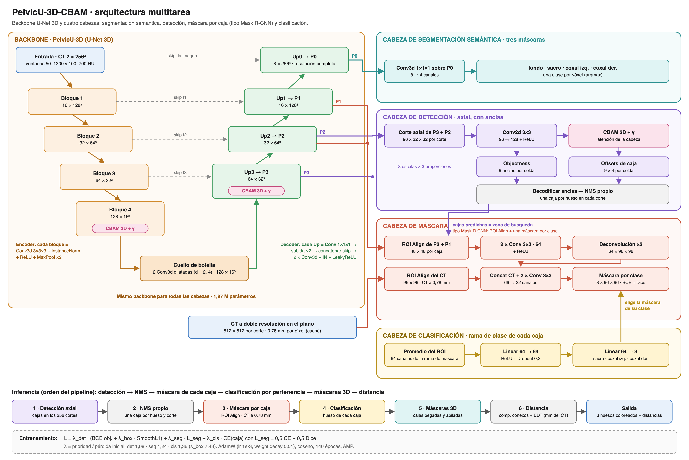

# proyecto2-analitica-de-datos — Detección de fracturas pélvicas en TC (PENGWIN)


**Universidad Autónoma de Occidente**<br>
**Materia:** Analítica de Datos<br>
**Estudiantes:** Mariana Cifuentes, John David Franco, Estefanía Hernández, Natalia Paredes<br>
**Profesor:** Carlos Andrés Ferro Sánchez

---

## Descripción del repositorio

> ## ⚠️ **Uso exclusivamente académico: no es un dispositivo médico.**

Detección y segmentación de fracturas pélvicas en tomografías computarizadas del reto [PENGWIN](https://grand-challenge.org) (100 casos de entrenamiento). El sistema localiza los tres huesos de la pelvis (sacro, coxal izquierdo, coxal derecho), separa los fragmentos desplazados de cada hueso y mide la distancia de separación del fragmento conminuto al principal en milímetros sobre la rejilla original del CT.

El modelo es una red propia llamada **PelvicU-3D-CBAM**, es multitarea y cuenta con _1,87 M de parámetros_: detección con anclas por corte, segmentación semántica 4 clases y máscara por fragmento. Se entrenaron dos variantes: CBAM (**PelvicU-3D-CBAM**, modelo final) y SE (**PelvicU-3D-SE**) como ablación de la atención, y se comparó contra un baseline zero-shot de SAM.

Todo es reproducible desde cero con `uv`: semilla fija (`config.SEED = 99`), splits versionados, hiperparámetros centralizados en `src/config.py` y **pesos finales incluidos en el repositorio**, por lo que no es necesario reentrenar:

| Modelo | Pesos |
| --- | --- |
| PelvicU-3D-CBAM (final) | `results/detection/unet3d_cbam_trab/best.pth` |
| PelvicU-3D-SE (ablación) | `results/detection/unet3d_se_trab/best.pth` |

### Ruta rápida: solo inferencia

Para usar el modelo ya entrenado sobre un CT no hace falta el dataset PENGWIN, ni las cachés, ni reentrenar: basta con el repositorio (que trae los pesos) y el CT. Funciona en GPU o en CPU (la red tarda ~1,4 s por CT en GPU y ~12 s en CPU).

1. Instalar el entorno (requiere `uv` y Python >= 3.12):

```bash
git clone https://github.com/HEstefaniaR/proyecto2-analitica-de-datos.git
cd proyecto2-analitica-de-datos
uv sync
```

2. Inferencia por línea de comandos. Acepta `.mha`, `.nii`, `.nii.gz` o una carpeta con serie DICOM, con cualquier número de cortes:

```bash
uv run python -m src.models.model3d infer ruta/al/ct.nii.gz
```

Opciones: `--out carpeta` (por defecto `results/inferencia/<nombre>/`), `--run unet3d_se_trab` (usa PelvicU-3D-SE en vez de PelvicU-3D-CBAM) y `--device cpu` (forzar CPU). Escribe las máscaras de los tres huesos en la rejilla del CT (`mascara_fusion.nii.gz` es la recomendada; se abren encima del CT en cualquier visor de NIfTI), las cajas por corte (`cajas.csv`, `cortes.csv`) y `resumen.json` con el volumen de cada hueso, los fragmentos separados y su distancia. Detalle en la Parte 6.

3. Inferencia desde el dashboard:

```bash
uv run streamlit run dashboard/app.py
```

Abrir `http://localhost:8501`, elegir "Subir CT" (volumen o serie de cortes), subir el archivo, elegir "Inferencia por corte" o "Reconstrucción 3D" y pulsar "Ejecutar inferencia". Detalle en la Parte 8.

### Requisitos mínimos para la inferencia (dashboard)

| Recurso | Mínimo |
| --- | --- |
| RAM | 16 GB |
| Memoria de GPU (VRAM) | ~2 GB (pico de 1,7 GB durante la inferencia del CT más pesado) |
| Tiempo por CT | ~6 s el pipeline completo con GPU |

- Navegador: cualquiera actual (Chrome, Edge, Firefox o Safari). La subida es por partes, así que admite CT de hasta 1024 MB también a través del túnel.
- Varias personas a la vez: cada una tiene su propia sesión y su propia subida. La inferencia corre de una en una en todo el servidor: si dos personas la piden al mismo tiempo, la segunda espera a que termine la primera (unos segundos). Así la memoria no se duplica y los resultados no se dañan.

**Archivos de prueba.** `ejemplos/` trae el CT 039 del conjunto de test (no se usó para entrenar) en los dos formatos que acepta el dashboard:

| Archivo | Formato en el dashboard | Por línea de comandos |
| --- | --- | --- |
| `ejemplos/ct_039.mha` | "Volumen (un archivo)" | `uv run python -m src.models.model3d infer ejemplos/ct_039.mha` |
| `ejemplos/ct_039_cortes/` (392 archivos) | "Serie de cortes (carpeta)" | — (`infer` acepta carpetas solo con serie DICOM) |

Los dos son el mismo CT, así que dan la misma predicción. Cada corte trae su posición, por lo que el dashboard toma la distancia entre cortes (0,8 mm) sin pedirla.

## Estructura del repositorio

```
proyecto2-analitica-de-datos/
├── src/                          # Código fuente (paquete src)
│   ├── config.py                 # Toda la configuración: SEED=99, rutas, hiperparámetros
│   ├── dataset/                  # preprocessing.py (cubo 400 mm), splits.py (70/15/15)
│   ├── models/                   # model3d.py (modelo 3D multitarea: entrenamiento, evaluación, inferencia),
│   │                             # detection.py (caché del cubo y componentes compartidos), segmentation.py, classification.py
│   ├── metrics/                  # distancias.py (EDT en mm), sam_baseline.py
│   └── inference.py              # Carga del checkpoint y predicción de un caso (la usa el dashboard)
├── results/
│   ├── detection/
│   │   ├── unet3d_cbam_trab/     # PelvicU-3D-CBAM: best.pth (pesos), config.json, history.csv, eval/ (métricas)
│   │   ├── unet3d_se_trab/       # PelvicU-3D-SE: best.pth (pesos), config.json, history.csv, eval/ (métricas)
│   │   ├── _archivo/             # Evaluaciones y experimentos anteriores
│   │   ├── anchors.json          # Estadísticas de las cajas usadas para las anclas
│   │   └── lambda_calibration.json  # Pérdidas iniciales para los pesos λ
│   ├── eda/                      # Tablas y figuras del EDA
│   ├── distancias/               # Distancias fragmento-principal del ground truth
│   ├── sam/                      # Baseline SAM zero-shot en test
│   └── splits/                   # Verificación de la división
├── docs/
│   ├── Informe técnico/          # Informe técnico PENGWIN.pdf
│   ├── Model Cards/              # model_card_PelvicU-3D-CBAM.pdf, model_card_PelvicU-3D-SE.pdf
│   ├── figuras/informe/          # Figuras del informe (distancias, galería de errores, matriz de confusión)
│   └── PelvicU-3D-CBAM_arquitectura.png  # Diagrama de la arquitectura
├── notebooks/                    # 01 EDA · 02 backbone · 03 evaluación 3D · 04 distancias · 05 splits
├── dashboard/                    # App Streamlit: app.py, estado.py, views/ (tres visualizadores), subida_partes/
├── scripts/                      # Baseline SAM 3D, distancias GT, galería de errores, verificación, despliegue
├── splits/splits.csv             # División train/val/test por caso (versionada)
├── ejemplos/                     # CT 039 de test para probar la inferencia: ct_039.mha (volumen)
│                                 # y ct_039_cortes/ (el mismo CT, un .mha por corte)
├── data/                         # Dataset PENGWIN y cachés (no se suben; ver Parte 2)
├── IA_USAGE.md                   # Declaración de uso de IA y prompts
├── pyproject.toml                # Dependencias (uv) + uv.lock + requirements.txt exportado
└── .streamlit/config.toml        # maxUploadSize 1024 MB para CT grandes
```

Los comandos de esta guía se ejecutan siempre **desde la raíz del proyecto**.

**Archivos que no se suben al repositorio** (están en `.gitignore`): el dataset y las cachés de `data/`, los `last.pth` de cada run, el checkpoint de SAM (`models/sam/`), las inferencias (`results/inferencia/`) y las predicciones guardadas por el dashboard (`results/dashboard_cache/`). Todos se regeneran con los comandos de esta guía.

---

## Parte 1 - Entorno

Requiere `uv` y Python >= 3.12. En Windows/Linux se instala la rueda de PyTorch con CUDA (cu126); en macOS, la de PyPI (MPS). El dispositivo se elige solo (`cuda` -> `mps` -> `cpu`) y se puede forzar con `--device` en cualquier comando.

```bash
git clone https://github.com/HEstefaniaR/proyecto2-analitica-de-datos.git
cd proyecto2-analitica-de-datos
uv sync
```

`requirements.txt` es un export de `uv.lock` por si se prefiere pip.

## Parte 2 - Datos y splits

El dataset (~21 GB) no se sube al repositorio. Descargar el training set de PENGWIN y colocarlo así:

```
data/
├── PENGWIN_CT_train_images_part1/*.mha   # volúmenes (100 casos entre las dos carpetas)
├── PENGWIN_CT_train_images_part2/*.mha
└── PENGWIN_CT_train_labels/*.mha         # códigos: 1-10 sacro, 11-20 coxal izq., 21-30 coxal der.
```

Generar los splits (70 % train / 15 % val / 15 % test, estratificados por tipo de fractura):

```bash
uv run python -m src.dataset.splits
```

Escribe `splits/splits.csv` (`case_id, split, stratum, fracture_type`). El archivo ya está versionado y se regenera idéntico gracias a la semilla 99; el notebook 05 lo verifica caso por caso.

## Parte 3 - Preprocesamiento (cachés)

`src/dataset/preprocessing.py` aplica exactamente lo mismo en entrenamiento e inferencia: reorientación a LPS, remuestreo a un cubo isótropo de 400 mm con 256³ vóxeles (1,5625 mm, relleno con aire, centrado en el FOV y en los cortes con hueso) y ventana HU 50-1300 reescalada a [0, 1].

Para entrenar y evaluar hacen falta dos cachés de los 100 casos (se generan una vez):

```bash
# Cubo 256³ (~3,3 GB en data/cache_cubo_400mm_256/)
uv run python -m src.models.detection cache

# Cubo a doble resolución en el plano axial (512 × 512 a 0,78 mm) para la cabeza de máscara
# (data/cache_cubo_400mm_256_axial512/)
uv run python -m src.models.model3d cache-hires
```

Si se cambia algún parámetro del preprocesamiento en `src/config.py` hay que repetirlas con `--overwrite`. La inferencia (`infer` y el dashboard) no usa estas cachés: arma el cubo y la doble resolución en el momento a partir del CT.

## Parte 4 - El modelo: PelvicU-3D-CBAM

Todos los hiperparámetros viven en `src/config.py` (semilla 99, épocas, lr, anclas, umbrales, anchos de canal).



**PelvicU-3D-CBAM** (`src/models/model3d.py`, modelo final): U-Net 3D sobre el cubo completo con dos canales de entrada (ventana ósea 50-1300 HU y ventana trabecular 100-700 HU). Encoder de cuatro bloques (Conv3d + InstanceNorm, 16-32-64-128 canales), cuello con convoluciones dilatadas y decoder P3-P0 hasta la resolución completa. CBAM 3D con ganancia γ en el bloque 4 del encoder, en P3 y en la cabeza de detección. Es multitarea: detección 2D con anclas por corte axial, segmentación semántica 4 clases (fondo + 3 huesos), máscara por fragmento con ROI Align sobre cada caja y clasificación de cada caja (sacro, coxal izquierdo, coxal derecho). Un paso = un CT completo; con gradient checkpointing y precisión mixta entrena en una GPU de 6 GB.

Las variantes se eligen con `--attention`: `cbam` → `unet3d_cbam_trab` (PelvicU-3D-CBAM, final), `se` → `unet3d_se_trab` (PelvicU-3D-SE, ablación) y `none` → `unet3d_sin_atencion` (sin atención; no se entrenó para la entrega).

## Parte 5 - Entrenamiento y evaluación

Pipeline completo, en orden (requiere los datos de la Parte 2 y las dos cachés de la Parte 3). Antes de entrenar en una máquina nueva conviene pasar la prueba de correctitud y medir memoria.

1. Overfit de un batch fijo (debe llevar la pérdida a ~0):

```bash
uv run python -m src.models.model3d overfit
```

2. Memoria y tiempo de un paso del modelo 3D:

```bash
uv run python -m src.models.model3d bench
```

3. Entrenamiento desde cero. Si se interrumpe, el mismo comando con `--resume` continúa desde `last.pth` (restaura modelo, optimizador, scheduler, época y RNG). Flags útiles: `--device`, `--epochs`, `--name`, `--workers`.

```bash
# PelvicU-3D-CBAM (run final) y PelvicU-3D-SE (ablación):
uv run python -m src.models.model3d train --attention cbam
uv run python -m src.models.model3d train --attention se

# Calibración de los pesos λ de las pérdidas (opcional; los valores ya están en src/config.py):
uv run python -m src.models.model3d calibrate
```

4. Evaluación. Evalúa validación y test y escribe en `results/detection/<run>/eval/` (métricas, casos, distancias, cabezas, instancias). Con `--keep-latency` conserva la latencia ya medida en vez de volver a medirla.

```bash
uv run python -m src.models.model3d evaluate --run unet3d_cbam_trab
uv run python -m src.models.model3d evaluate --run unet3d_se_trab
```

Cada run deja en `results/detection/<run>/`: `best.pth` (pesos de la mejor época), `last.pth` (estado para reanudar; no se sube al repositorio), `config.json`, `history.csv` (pérdidas, métricas y γ de cada capa por época) y los archivos de evaluación. Los experimentos históricos están archivados en `results/detection/_archivo/`.

## Parte 6 - Inferencia sobre un CT nuevo

Funciona con los pesos incluidos en el repositorio, sin dataset y sin reentrenar. Acepta `.mha`, `.nii`, `.nii.gz` o una carpeta con serie DICOM, con cualquier número de cortes:

```bash
uv run python -m src.models.model3d infer ruta/al/ct.nii.gz
```

Escribe en `results/inferencia/<nombre>/` (otra carpeta con `--out`): las máscaras de los tres huesos en la rejilla del CT (`mascara_semantica.nii.gz`, `mascara_cabeza.nii.gz` y la recomendada `mascara_fusion.nii.gz`: coxales de la cabeza de máscara y sacro de la semántica, más el sacro que marque la cabeza de máscara), las cajas de cada corte (`cajas.csv`), el resumen por corte (`cortes.csv`) y `resumen.json`. Con `--run unet3d_se_trab` usa PelvicU-3D-SE.

## Parte 7 - Notebooks

Ningún notebook entrena; todos leen archivos de `results/` ya generados, así que se ejecutan en cualquier orden tras las partes 2-5 (o directamente con los resultados versionados).

| Notebook | Qué hace |
| --- | --- |
| `01_EDA.ipynb` | Exploración del dataset PENGWIN: histogramas HU, cortes, fragmentos por caso, anomalías |
| `02_backbone_deteccion.ipynb` | Explica el backbone 3D, la atención CBAM + γ y la cabeza de detección de PelvicU-3D-CBAM |
| `03_evaluacion_modelo3d.ipynb` | Evaluación multitarea de PelvicU-3D-CBAM vs PelvicU-3D-SE: detección, semántica, máscara, clasificación |
| `04_distancias_fragmentos.ipynb` | Resúmenes e histogramas de las distancias fragmento-principal del ground truth |
| `05_verificacion_division.ipynb` | Verifica la división train/val/test: reproducción exacta, fugas, dificultad relativa |

Scripts auxiliares en `scripts/` (el uso de cada uno está en su encabezado): baseline zero-shot de SAM en 3D (requiere el checkpoint ViT-B `sam_vit_b_01ec64.pth` en `models/sam/`, no se sube), distancias del ground truth, galería de errores de test (`inferir_casos_test.py` y luego `crear_galeria_errores_test.py`), comparación de cabezas de segmentación y despliegue del dashboard.

## Parte 8 - App de visualizadores (dashboard)

App de Streamlit (`dashboard/app.py`) que carga el modelo final ya entrenado (`results/detection/unet3d_cbam_trab/best.pth`, incluido en el repo) y permite explorar un CT y su predicción. Se lanza desde la raíz y abre en `http://localhost:8501`:

```bash
uv run streamlit run dashboard/app.py
```

Cómo usarla:

1. **Elegir el caso** en la barra lateral:
   - "Caso del dataset": los 15 CT de test (requiere los `.mha` en `data/`).
   - "Subir CT": un volumen en un solo archivo (`.mha`, `.nii`, `.nii.gz`) o una serie de cortes (carpeta con un archivo por corte). La subida se hace por partes, así que funciona con CT grandes (hasta 1024 MB) y a través del túnel. Si los cortes no traen la distancia entre ellos, la app la pide (1,0 mm por defecto).
2. **Elegir el visualizador** y, en los dos últimos, pulsar "Ejecutar inferencia":
   - **Volumen crudo** (sin modelo): corte a corte con slider y ventana HU ajustable; MIP 2D en los tres planos con máscara de hueso por umbral; reconstrucción 3D por marching cubes con controles de umbral, volumen mínimo y resolución de malla.
   - **Inferencia por corte**: overlay 2D del pipeline completo sobre el corte axial — cajas de detección, máscaras de fragmentos coloreadas por hueso (sacro / coxales), distancias de separación en mm, latencia y tabla de fragmentos.
   - **Reconstrucción 3D**: mallas interactivas (Plotly) por fragmento coloreadas por hueso y la línea 3D de la medición de separación con su valor en mm.
3. Las predicciones se guardan en `results/dashboard_cache/` para no repetir cómputo; se puede borrar la carpeta sin riesgo.

Sin dataset la app funciona en modo "Subir CT"; sin `best.pth` los dos visualizadores de inferencia no funcionan (el "Volumen crudo" sí).

**Despliegue con un túnel de Cloudflare.** Para abrir el dashboard desde otro computador o desde un celular, se levanta Streamlit en la máquina local y un túnel rápido de Cloudflare (sin cuenta), que muestra una dirección pública `https://<algo>.trycloudflare.com`. La dirección funciona mientras el túnel esté abierto; Ctrl+C lo cierra. El modelo sigue corriendo en la máquina local.

*macOS y Linux:*

```bash
# Instalar cloudflared (una vez)
brew install cloudflared                                     # macOS
curl -L https://github.com/cloudflare/cloudflared/releases/latest/download/cloudflared-linux-amd64.deb -o cloudflared.deb
sudo dpkg -i cloudflared.deb                                 # Linux (Debian / Ubuntu)

# Dashboard + túnel
bash scripts/desplegar_dashboard.sh
```

*Windows:* instalar `cloudflared` y correr el mismo script desde Git Bash:

```bash
winget install --id Cloudflare.cloudflared
bash scripts/desplegar_dashboard.sh
```

Sin Git Bash, en PowerShell, los dos pasos del script a mano (cada uno en su propia terminal, desde la raíz del proyecto):

```powershell
.venv\Scripts\python.exe -m streamlit run dashboard/app.py --server.port 8501 --server.address 127.0.0.1
cloudflared tunnel --url http://127.0.0.1:8501
```

Otro puerto con el script: `PUERTO=8600 bash scripts/desplegar_dashboard.sh`.

## Parte 9 - Resultados de referencia

Cifras oficiales de la entrega, tomadas de `results/detection/<run>/eval/metrics.json` (claves `detection.m0.all`, `segmentation_pelvis.dice`, `separation_distance.mae_mm` y `classification_end_to_end.macro_f1`). Para validar una reproducción basta con reejecutar los comandos `evaluate` de la Parte 5 y comparar.

| Modelo | Split | mAP50 (det.) | mAP50-95 | Dice pelvis | Sep. MAE | Macro F1 |
| --- | --- | --- | --- | --- | --- | --- |
| PelvicU-3D-CBAM (`unet3d_cbam_trab`, final) | val | 0,929 | 0,804 | 0,958 | 4,17 mm | 1,000 |
| PelvicU-3D-CBAM (`unet3d_cbam_trab`, final) | test | 0,959 | 0,806 | 0,954 | 1,81 mm | 1,000 |
| PelvicU-3D-SE (`unet3d_se_trab`, ablación) | val | 0,929 | 0,801 | 0,958 | 4,11 mm | 1,000 |
| PelvicU-3D-SE (`unet3d_se_trab`, ablación) | test | 0,940 | 0,798 | 0,953 | 1,81 mm | 1,000 |

Referencia adicional: el baseline SAM ViT-B zero-shot en test obtuvo Dice 3D macro 0,881 frente a 0,952 del modelo (`results/sam/resumen_3d_test.md`). Las dos variantes quedan empatadas en validación (0,804 vs 0,801 de mAP50-95) y CBAM gana por poco en test.

Resumen de lo que hace cada pieza reproducible: semilla 99 en splits y entrenamiento (`seed_everything`), hiperparámetros en `src/config.py`, entorno cerrado en `uv.lock`, splits versionados en `splits/splits.csv` y pesos finales versionados, de modo que entrenamiento, evaluación, inferencia y dashboard se replican sin depender de ningún artefacto externo.
